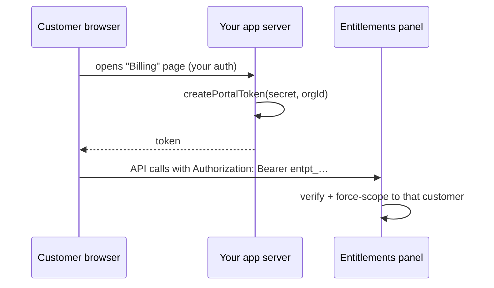

# Portal

The customer portal shows your customers **their own** plan, usage against limits, the plans they
could move to, and links out to your billing provider's checkout and billing portal — from inside
your product. It is not a second API or a second UI: the same routes and the same SPA bundle,
force-scoped by a signed token (ADR 0010). Invoices, payment methods and receipts stay with the
provider (ADR 0015).

## The flow



## 1. Configure the panel

```ts
entitlementsPanel({
  catalog,
  storage,
  counters,
  portal: { secret: process.env.PORTAL_SECRET! }, // any strong random string
  billing, // optional: createBilling(engine, { providers }) enables the link-outs
});
```

## 2. Mint tokens server-side

```ts
import { createPortalToken } from "@xtandard/entitlements";

// In a route handler of YOUR app, after your own auth:
app.get("/api/billing-portal-token", async (ctx) => {
  const org = await requireOrg(ctx);
  return { token: await createPortalToken(process.env.PORTAL_SECRET!, org.id) };
});
```

`createPortalToken(secret, customer, { expiresIn, scope })`:

- `expiresIn` defaults to `"1h"` (`"15m"`, `"1d"`, milliseconds, …);
- `scope` defaults to every portal action — `["portal:read", "portal:checkout", "portal:manage"]`.
  Pass `["portal:read"]` for a view-only portal (e.g. for non-owner members: no upgrade or
  manage-billing buttons).

The token is `entpt_` + base64url(`{ customer, exp, scope }`) + `.` + base64url(HMAC-SHA256);
verification (`verifyPortalToken`) is stateless, signature-first and constant-time.

## 3. Embed

React (see the UI docs for props):

```tsx
import { CustomerPortal } from "@xtandard/entitlements/react/embed";

<CustomerPortal apiBaseUrl="/billing" token={token} />;
```

Or open the panel itself with the token: the SPA sends it as `Authorization: Bearer` on every API
call, `/config` answers `mode: "portal"` (with the `customer` and `scope`), and the UI renders the
reduced customer chrome.

## The portal API

| Route                       | Action            | Response                                                                         |
| --------------------------- | ----------------- | -------------------------------------------------------------------------------- |
| `GET /api/portal/me`        | `portal:read`     | `PortalView`: entitlements + usage, `profile`, public `pricing`, link-out flags  |
| `POST /api/portal/checkout` | `portal:checkout` | `{ url }` — provider checkout for `{ plan, quantity?, successUrl?, cancelUrl? }` |
| `POST /api/portal/manage`   | `portal:manage`   | `{ url }` — provider billing portal for `{ returnUrl? }`                         |

`canCheckout` / `canManage` in `PortalView` are true only when a billing provider supports the
link-out **and** the token's scope allows it. Without `billing`, checkout / manage answer `404`.

## Scoping guarantees

- Only the token's customer: the portal routes always act on it — a `?customer=` parameter is
  ignored for portal principals.
- Only the portal routes, and only the token's scope: admin, runtime and out-of-scope portal routes
  answer `403`.
- Expired / tampered / malformed tokens: `401 { code: "PORTAL_TOKEN" }`, always — a
  presented-but-invalid portal token never falls back to host auth.
- The host's authorization provider is **not consulted** for portal principals (ADR 0010).
- Portal principals appear as `{ id: "portal:<customer>", metadata: { portal: true, customer } }`
  (actor `type: "portal"`).

## Admin preview

Admin principals can open any customer's portal with `?customer=<id>` — handy for support ("this
is what the customer sees"). Those calls go through your authorization provider with the portal
actions and `{ type: "portal", customer }` (the `admin` role preset allows them; `viewer` does
not).

## Operational notes

- Tokens are bearer credentials: HTTPS only, keep `expiresIn` short, mint fresh per page load
  rather than storing them.
- Revocation before expiry = rotate `PORTAL_SECRET` (invalidates every outstanding token).
- The CLI / standalone image accept `PORTAL_SECRET` as an env var.
