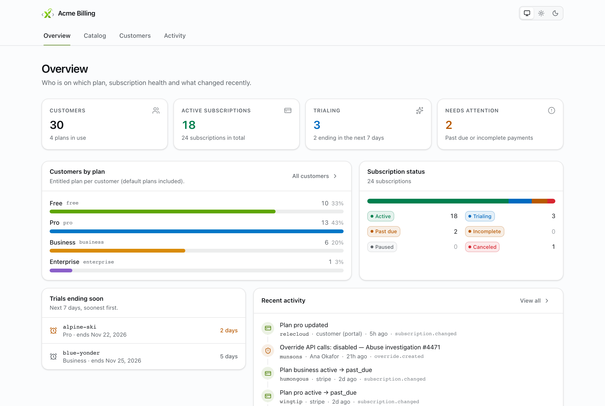
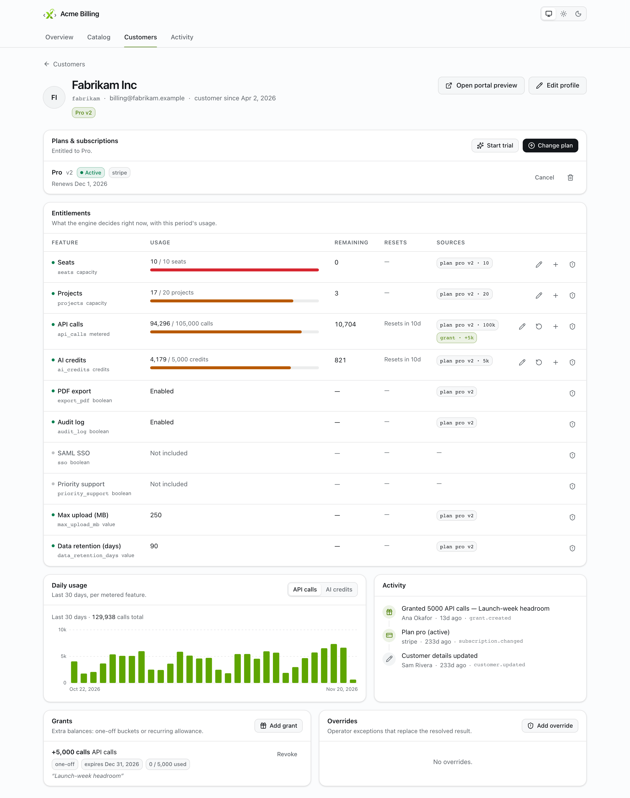
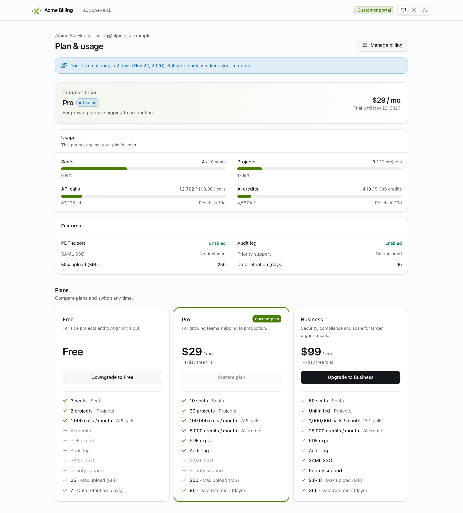
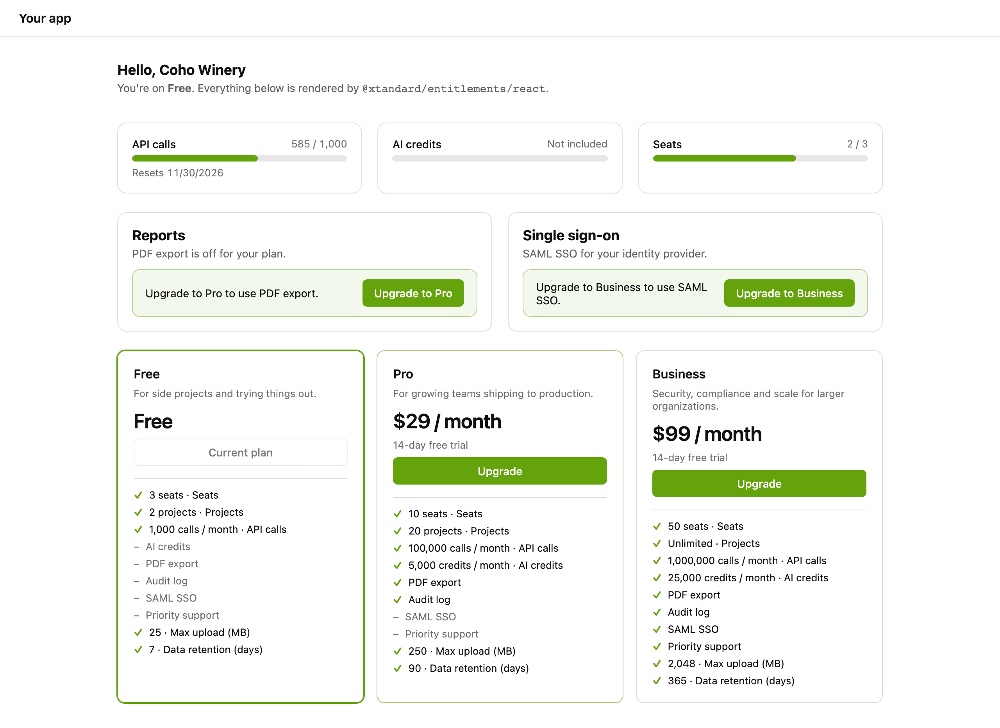

# UI

Three ways to put entitlements on screen, from smallest to largest:

| What                                                       | Import                               | Size         | For                                                                  |
| ---------------------------------------------------------- | ------------------------------------ | ------------ | -------------------------------------------------------------------- |
| **Hooks + components** (`<Gate>`, `<UsageMeter>`, …)       | `@xtandard/entitlements/react`       | ~6 kB gzip   | gating _your product's_ UI: hide a button, show a meter, upsell      |
| **Embeds** (`<EntitlementsDashboard>`, `<CustomerPortal>`) | `@xtandard/entitlements/react/embed` | the full SPA | the admin or the customer portal inside your own React app           |
| **The bundled SPA**                                        | served by every adapter              | —            | admin + customer portal at the panel's mount point, no React in host |

Same design system as `@xtandard/flags` and `@xtandard/webhooks` (Tailwind v4 tokens, Base UI
primitives, lucide icons, light/dark), with the lime accent of the entitlements brand
([BRAND.md](./BRAND.md)).



## The bundled SPA

Served by every adapter under the panel's `basePath` (see [ADAPTERS](./ADAPTERS.md)). One bundle,
two chromes: the request's credentials decide which (`GET /config` → `mode`).

### Admin

| View      | What it shows / does                                                                                                                                                                                                                                                                                                                                                                                                                                                                                                                                                                                                                           |
| --------- | ---------------------------------------------------------------------------------------------------------------------------------------------------------------------------------------------------------------------------------------------------------------------------------------------------------------------------------------------------------------------------------------------------------------------------------------------------------------------------------------------------------------------------------------------------------------------------------------------------------------------------------------------- |
| Overview  | customer count, active / trialing / past-due subscriptions, customers by plan, subscription statuses, trials ending in the next 7 days, recent activity                                                                                                                                                                                                                                                                                                                                                                                                                                                                                        |
| Catalog   | the features × plans matrix (current versions; toggles for previous versions and hidden plans), add-ons, provider mappings (price / product ids per plan) and a preview of the public pricing table. Read-only: the catalog is code ([ADR 0002](./ADR/0002-catalog-as-code.md))                                                                                                                                                                                                                                                                                                                                                                |
| Customers | search (id, name, email) and cursor pagination; plan chips and status badges                                                                                                                                                                                                                                                                                                                                                                                                                                                                                                                                                                   |
| Customer  | profile (edit name / email); plans & subscriptions (status, trial / period end, cancel at period end, **change plan**, **start trial**, cancel / resume / remove, **migrate** a grandfathered version); the **entitlements table** (kind, limit, used, remaining, reset, source chips plan / add-on / grant / override, usage bars coloured at 75 % and 90 %); **grants** (amount, expiry, priority, recurring, reason; revoke); **overrides** (enable / disable / limit / unlimited / value, expiry, reason; remove); set / reset usage; a 30-day **daily usage chart** per metered feature; the customer's activity; **Open portal preview** |
| Activity  | every control-plane change, filterable by kind and customer                                                                                                                                                                                                                                                                                                                                                                                                                                                                                                                                                                                    |

Every mutation is a dialog with inline validation and a toast; destructive ones ask first.
`readonly: true` on the panel hides every mutation (the API answers `423` anyway).



### Customer portal

The same bundle in portal mode — no navigation, one page for one customer:

- current plan, price and status, with banners for trials ("ends in 2 days"), failed payments
  (past due) and scheduled cancellations;
- usage vs. limits for every metered, credits and capacity feature, with "resets in";
- the included features;
- the plan comparison (the public pricing table, current plan marked). **Upgrade / Downgrade**
  calls `POST /api/portal/checkout` and redirects to the provider's checkout; buttons are disabled
  with a hint when `canCheckout` is false (no billing provider with `createCheckout`, or a view-only
  token). Moving to the free default plan goes through **Manage billing** (it is a cancellation);
- **Manage billing** (`POST /api/portal/manage`) when `canManage`.

How a customer gets there: your app mints a portal token after its own authentication and links
to the panel with the token in the URL fragment —

```ts
import { createPortalToken } from "@xtandard/entitlements";

const token = await createPortalToken(process.env.PORTAL_SECRET!, org.id, { expiresIn: "1h" });
return redirect(`/billing/#token=${token}`); // `?token=` works too
```

The SPA moves the token from the URL into memory (and out of the address bar) and sends it as
`Authorization: Bearer entpt_…`. Admins see any customer's portal with **Open portal preview**
(`/portal?customer=<id>`). Tokens, scopes and revocation: [PORTAL](./PORTAL.md).



## `@xtandard/entitlements/react` — hooks and components

For your **product** UI. Plain React (18 or 19, an optional peer), no other dependencies, unstyled.

> **Client-side gates are UX, not security.** They decide what to _show_. Anyone can flip a boolean
> in devtools. Enforce on the server with `ent.check()` / `ent.consume()` or the adapters'
> `requireEntitlement` guards ([ADAPTERS](./ADAPTERS.md), [ADR 0009](./ADR/0009-decisions-and-denials.md)).

```tsx
import {
  EntitlementsProvider,
  Gate,
  PricingTable,
  UpgradePrompt,
  UsageMeter,
} from "@xtandard/entitlements/react";
import "@xtandard/entitlements/react/components.css"; // optional default styles

export function App({ portalToken }: { portalToken: string }) {
  return (
    <EntitlementsProvider baseUrl="/billing" token={portalToken}>
      <Gate feature="export_pdf" fallback={<UpgradePrompt feature="export_pdf" />}>
        <ExportButton />
      </Gate>
      <UsageMeter feature="api_calls" />
      <PricingTable onSelect={(plan) => startCheckout(plan)} />
    </EntitlementsProvider>
  );
}
```

### `EntitlementsProvider`

Loads one customer's entitlements once and shares them. One source:

| Prop                | Source                                                                                              |
| ------------------- | --------------------------------------------------------------------------------------------------- |
| `baseUrl` + `token` | `GET {baseUrl}/api/portal/me` with the portal token. `token` may be a function (re-mint on expiry). |
| `fetcher`           | your own loader (your API route, a server action, a test double) returning the same shape           |
| `initial`           | server-rendered data (SSR / RSC): rendered immediately, no fetch on mount; `refresh()` reloads      |

Also `credentials`, `refreshInterval` (ms), `onError`. The provider is read-only: refresh after
your server consumed usage (`useEntitlements().refresh()`), it does not count locally.

### Hooks

| Hook                                  | Returns                                                                                                                                  |
| ------------------------------------- | ---------------------------------------------------------------------------------------------------------------------------------------- |
| `useEntitlement(feature, { amount })` | `{ allowed, enabled, kind, limit, used, remaining, overage, value, resetsAt, loading, unlockedBy }` — computed client-side from the data |
| `useEntitlements()`                   | `{ data, loading, error, refresh(), checkout?(plan) }` (`checkout` links out via `POST /api/portal/checkout` when `baseUrl` is set)      |
| `useCustomer()`                       | `{ id, name, email, plan, planName, status, isDefault, trialEndsAt, periodEnd, cancelAtPeriodEnd, canCheckout, canManage, loading }`     |

`allowed` mirrors the engine's decision (limits, overage policy and caps, one-off grants, overrides)
and `unlockedBy` lists the public plans / add-ons that would allow it, cheapest first — the same
rule as the server's `unlockedBy`.

### Components

All take `className` and render `data-*` attributes to style against.

| Component                                                                        | Renders                                                                                                                                                                                                                                                       |
| -------------------------------------------------------------------------------- | ------------------------------------------------------------------------------------------------------------------------------------------------------------------------------------------------------------------------------------------------------------- |
| `<Gate feature amount? fallback? loading?>`                                      | children when allowed, `fallback` otherwise; children may be a function of the state                                                                                                                                                                          |
| `<UsageMeter feature label? hideText?>`                                          | `role="progressbar"` with `aria-valuenow/max/text`; `data-level` = `ok \| warn \| critical \| unlimited \| disabled`; parts `label`, `value`, `track`, `fill`, `reset`                                                                                        |
| `<PricingTable pricing? \| catalog? currentPlan? onSelect? actionLabel? group?>` | `article[data-xe=plan]` per plan (`data-current`, `data-highlight`), price, trial, an action button (`data-relation` = `current \| upgrade \| downgrade \| choose`), feature list (`li[data-included]`). Without `pricing` / `catalog` it uses the provider's |
| `<UpgradePrompt feature amount? onUpgrade?>`                                     | "Upgrade to Pro to use PDF export" + a button, only when blocked and some plan would help (`data-reason` = `plan \| limit`); a render function for custom content                                                                                             |

`@xtandard/entitlements/react/components.css` styles them with a handful of variables
(`--xe-accent`, `--xe-warn`, `--xe-critical`, `--xe-radius`); neutral colours derive from
`currentColor`, so it suits light and dark hosts.



### Typed by your catalog

```ts
import type { catalog } from "./catalog";
import { createEntitlementsReact } from "@xtandard/entitlements/react";

export const { Gate, UsageMeter, useEntitlement, PricingTable } =
  createEntitlementsReact<typeof catalog>();

useEntitlement("max_upload_mb").value; // number
<UsageMeter feature="export_pdf" />; // ✗ type error: not a numeric feature
```

## `@xtandard/entitlements/react/embed` — dashboard and portal

The SPA as two React components, for hosts that want them inside their own React tree:

```tsx
import { CustomerPortal, EntitlementsDashboard } from "@xtandard/entitlements/react/embed";
import "@xtandard/entitlements/react/styles.css";

// Your billing settings page — token minted by your server after its own auth:
<CustomerPortal apiBaseUrl="/billing" token={portalToken} theme="inherit" />;

// Your internal admin:
<EntitlementsDashboard apiBaseUrl="/billing" />;
```

Props (both): `apiBaseUrl`, `credentials` / `fetch` (auth plumbing: `"include"` for cross-origin
cookies, a custom fetch for bearer schemes), `queryClient`, `theme`, `className`, `routing`
(`"hash"` default, `"browser"` + `routerBase`, `"memory"`, or a wouter hook), `logoUrl`;
`token` (portal only). React 18/19 are optional peers; TanStack Query, Base UI and the styles are
bundled. The stylesheet is scoped under `.xtandard-entitlements`, and popups and dialogs portal
into the wrapper, so nothing leaks into your app.

### Theme

The embed resolves one theme and applies it to its own wrapper
(`<div class="xtandard-entitlements" data-theme="…">`); it never writes to your document.

| `theme`              | Behaviour                                                                                                                                   | Switcher |
| -------------------- | ------------------------------------------------------------------------------------------------------------------------------------------- | -------- |
| `"auto"` (default)   | the panel's own system / light / dark switcher, persisted in `localStorage`                                                                 | shown    |
| `"inherit"`          | follows your app, live: a `dark` / `light` class or `data-theme` on `<html>` (then `<body>`), falling back to the OS `prefers-color-scheme` | hidden   |
| `"light"` / `"dark"` | forces one theme — pass your app's resolved value when it tracks the theme some other way                                                   | hidden   |

## Theming and branding

- `title` and `logoUrl` panel options set the header (the default is the entitlements mark and the
  title); `logoUrl` on an embed overrides both.
- Every colour, radius and font is a CSS custom property (`--background`, `--card`, `--accent`,
  `--ring`, `--chart-1`, `--radius`, …). Override them after importing the stylesheet — in the SPA
  on `:root` / `:root[data-theme="dark"]`, in an embed on `.xtandard-entitlements` /
  `.xtandard-entitlements[data-theme="dark"]`.
- Light mode uses the deep lime (`#4D7C0F`, AA on white) for accent text and the brighter lime for
  fills; dark mode uses `#A3E635` on charcoal.

## Develop

```sh
bun run build        # library + dist/ui + dist/react-embed.js / react.css
bun run demo         # the panel on http://localhost:7789 with the seeded demo data
bun run test:e2e     # Playwright: admin, portal, embeds, light + dark
bun run screenshots  # regenerate docs/assets/ui-*.png from the demo
```
